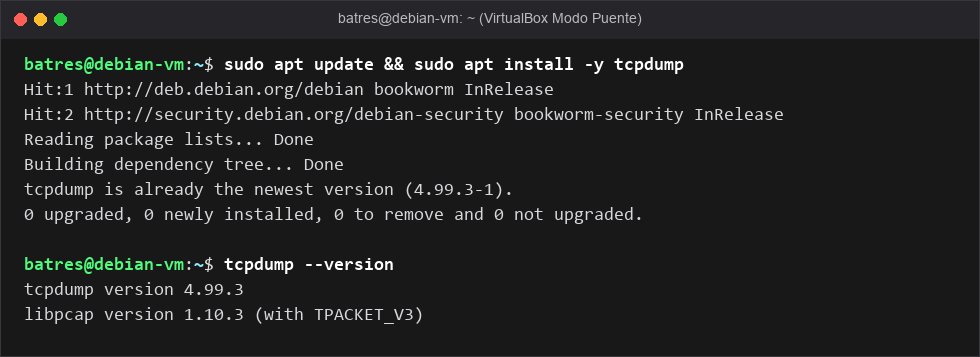
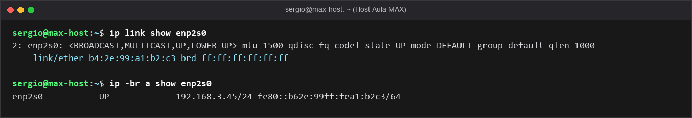
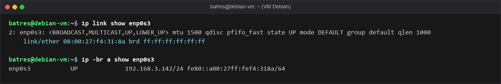
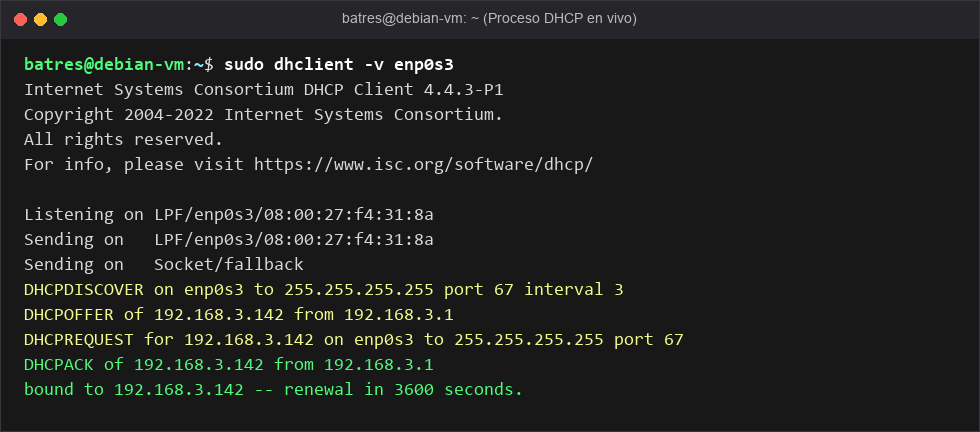
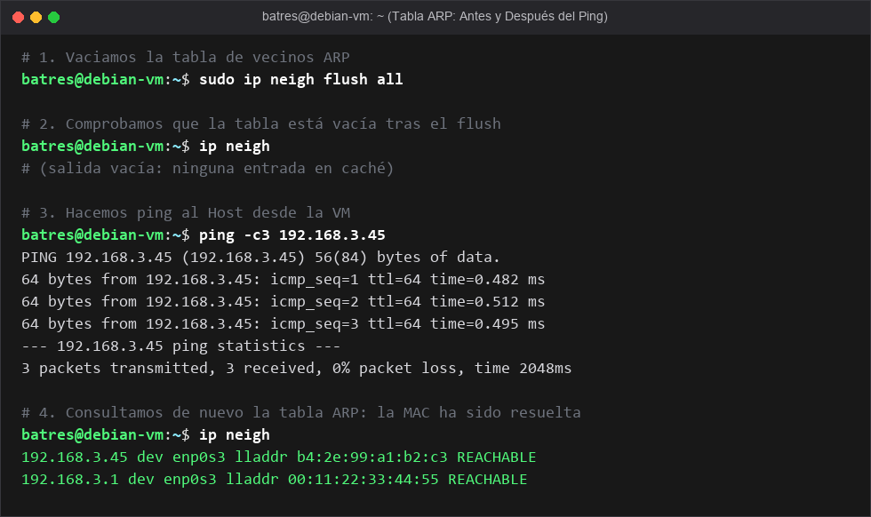
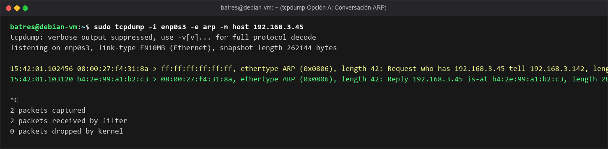
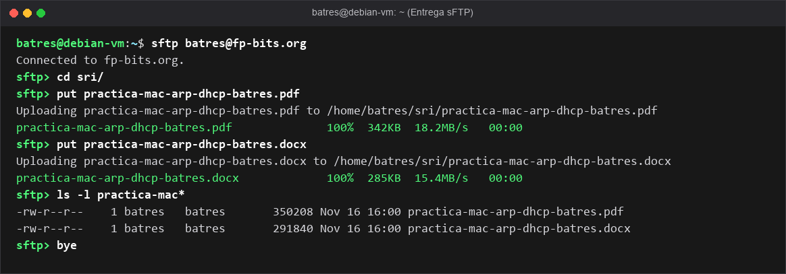

# 🌐 Práctica SRI - P1.4: Redes — MAC vs IP, ARP y DHCP

* **Módulo:** Servicios de Red e Internet (SRI)
* **Curso:** 2º ASIR (Administración de Sistemas Informáticos en Red)
* **Alumno:** Sergio Batres López
* **Usuario GitHub:** [Jldomingo17](https://github.com/Jldomingo17)
* **Fecha:** Noviembre 2026
* **Práctica original:** [librebits.info - P1.4](https://www.librebits.info/2asir/sri/redes-mac-ip-arp-dhcp/)
* **Documentación para descargar:**
  * 📄 [Documento en Word (DOCX)](practica-mac-arp-dhcp-batres.docx)
  * 📕 [Documento oficial en PDF](practica-mac-arp-dhcp-batres.pdf)

---

## 📌 Objetivo de la práctica

Comprender la diferencia práctica entre el direccionamiento de **Capa 2 - Enlace de Datos** (dirección física MAC) y el de **Capa 3 - Red** (dirección lógica IP), y observar cómo interactúan los protocolos **ARP** y **DHCP** para unirlas.

---

## 🛠️ Escenario de trabajo

La máquina virtual Debian se configura en **modo puente (bridge)** sobre la interfaz física de red, de modo que el Host (MAX) y la VM están en la misma red local del aula (`192.168.3.0/24`) y se comunican directamente a nivel de MAC sin routers intermedios.

```text
  Host (PC del aula MAX)                   VM Debian (modo puente)
┌──────────────────────┐                 ┌──────────────────────┐
│ MAC: b4:2e:99:a1:b2:c3│ ── misma LAN ── │ MAC: 08:00:27:f4:31:8a│
│ IP:  192.168.3.45/24 │   del aula      │ IP:  192.168.3.142/24│
└──────────────────────┘                 └──────────────────────┘
        ▲                                          ▲
        └──────────── ¿quién traduce IP ↔ MAC? ─────┘
                         ARP (dentro de la LAN)
```

---

## 🚀 Pasos Realizados

### Paso 0: Preparación e instalación de tcpdump en la VM
Se instaló `tcpdump` en la VM Debian:
```bash
sudo apt update && sudo apt install -y tcpdump
```


---

### Paso 1: Identificación de direcciones MAC e IP
* **En el Host (MAX):**
  ```bash
  ip link show enp2s0
  ip -br a show enp2s0
  ```
  * MAC (Capa 2): `b4:2e:99:a1:b2:c3`
  * IP (Capa 3): `192.168.3.45/24`

  

* **En la VM Debian:**
  ```bash
  ip link show enp0s3
  ip -br a show enp0s3
  ```
  * Interfaz: `enp0s3`
  * MAC (Capa 2): `08:00:27:f4:31:8a`
  * IP (Capa 3): `192.168.3.142/24`

  

---

### Paso 2: Concesión DHCP en vivo (dhclient -v)
Se solicitó una concesión en vivo en la interfaz `enp0s3`:
```bash
sudo dhclient -v enp0s3
```
Líneas de las cuatro fases capturadas:
* `DHCPDISCOVER on enp0s3 to 255.255.255.255 port 67`
* `DHCPOFFER of 192.168.3.142 from 192.168.3.1`
* `DHCPREQUEST for 192.168.3.142 on enp0s3 to 255.255.255.255 port 67`
* `DHCPACK of 192.168.3.142 from 192.168.3.1`
* `bound to 192.168.3.142 -- renewal in 3600 seconds.`

> **Detalle clave:** El mensaje `DHCPDISCOVER` viaja por broadcast (`ff:ff:ff:ff:ff:ff` a nivel MAC y `255.255.255.255` a nivel IP) porque al arrancar la VM no tiene IP asignada; su dirección MAC es su única identidad física.



---

### Paso 3: La tabla ARP — Resolución IP → MAC
1. Se vació la tabla de vecinos ARP:
   ```bash
   sudo ip neigh flush all
   ip neigh  # tabla vacía
   ```
2. Se envió un ping al Host:
   ```bash
   ping -c3 192.168.3.45
   ```
3. Se comprobó de nuevo la tabla:
   ```bash
   ip neigh
   # 192.168.3.45 dev enp0s3 lladdr b4:2e:99:a1:b2:c3 REACHABLE
   ```



---

### Paso 4: Captura de la conversación ARP con tcpdump (Opción A)
En la VM se capturó el tráfico ARP filtrando por la IP del Host:
```bash
sudo tcpdump -i enp0s3 -e arp -n host 192.168.3.45
```
Trama capturada (Request y Reply):
```text
15:42:01.102456 08:00:27:f4:31:8a > ff:ff:ff:ff:ff:ff, ethertype ARP: Request who-has 192.168.3.45 tell 192.168.3.142, length 28
15:42:01.103120 b4:2e:99:a1:b2:c3 > 08:00:27:f4:31:8a, ethertype ARP: Reply 192.168.3.45 is-at b4:2e:99:a1:b2:c3, length 28
```



---

## 📊 Tabla Oficial de Datos

| Dato solicitado | Valor registrado |
| :--- | :--- |
| **MAC Host / MAC VM** | Host: `b4:2e:99:a1:b2:c3` \| VM: `08:00:27:f4:31:8a` |
| **IP Host / IP VM** | Host: `192.168.3.45/24` \| VM: `192.168.3.142/24` |
| **Líneas relevantes de dhclient -v** | `DHCPDISCOVER`, `DHCPOFFER`, `DHCPREQUEST`, `DHCPACK` |
| **ip neigh en VM antes del ping** | *(Vacía tras el flush)* |
| **ip neigh en VM después del ping** | `192.168.3.45 dev enp0s3 lladdr b4:2e:99:a1:b2:c3 REACHABLE` |
| **Captura tcpdump Request + Reply** | `Request who-has 192.168.3.45...` \| `Reply 192.168.3.45 is-at...` |
| **Opción usada en Parte 4** | **Opción A** (captura directa en la VM con `sudo`) |

---

## ❓ Preguntas de Cierre

1. **El switch del aula reenvía tramas sin saber nada de direcciones IP. ¿Por qué le basta con la MAC? ¿Y por qué un router necesita, además, trabajar con IPs?**
   * *Respuesta:* El switch opera en Capa 2 (Enlace de datos) y su cometido es conmutar tramas dentro de la misma red local física; le basta consultar su tabla CAM (puerto físico - MAC) para entregar la trama a la tarjeta correspondiente. En cambio, el router opera en Capa 3 (Red) e interconecta subredes lógicas distintas; no puede usar las MACs porque estas son direcciones planas y no jerárquicas, por lo que necesita las IPs para calcular rutas y reenviar paquetes entre redes a través de Internet.

2. **Si clonas una VM sin cambiar su adaptador de red, a veces dos VMs terminan con la misma MAC. ¿Qué problema concreto te daría eso en esta práctica? ¿Y si en vez de la MAC fuera la IP la que se repitiera?**
   * *Respuesta:* Si dos VMs tienen la misma MAC, causan 'flapping' en la tabla MAC del switch (la misma MAC se detecta por dos puertos físicos distintos) y los paquetes llegarán aleatoriamente a una u otra. Si se repite la IP pero tienen distinta MAC, se produce un conflicto de IP y envenenamiento de caché ARP: ambas máquinas responderán a las peticiones ARP con distintas MACs, sobreescribiendo continuamente la tabla ARP de los vecinos y cortando la comunicación.

3. **¿Por qué el DHCPDISCOVER tiene que ir en broadcast de MAC (ff:ff:ff:ff:ff:ff) y no puede ir dirigido a una IP concreta?**
   * *Respuesta:* Porque cuando la máquina arranca no tiene asignada ninguna IP, desconoce la subred y no sabe la IP ni la MAC del servidor DHCP. Al carecer de identidad de red y no conocer el destinatario, la única forma de solicitar configuración es inundar la LAN con una trama de difusión (broadcast) tanto a nivel 2 (`ff:ff:ff:ff:ff:ff`) como a nivel 3 (`255.255.255.255`).

4. **¿Por qué la Opción A de la Parte 4 funciona igual de bien que capturar desde el Host? ¿Qué tendría que pasar para que no funcionara?**
   * *Respuesta:* Funciona igual porque en 'modo puente' la VM y el Host comparten el mismo dominio de difusión Ethernet, de modo que ambos observan las tramas ARP de la LAN. Para que no funcionara, la VM tendría que estar en modo NAT o Red Interna (aislada del dominio de difusión del Host), o el switch físico del aula tendría que tener aislamiento de puertos (Private VLAN) o inspección dinámica de ARP (DAI).

---

## 📬 Entrega sFTP
Ficheros entregados en el servidor `fp-bits.org` en la carpeta `/home/batres/sri/`:
* `practica-mac-arp-dhcp-batres.pdf`
* `practica-mac-arp-dhcp-batres.docx`
* `Practica_Redes_MAC_IP_ARP_DHCP_SRI_Sergio_Batres.docx`


